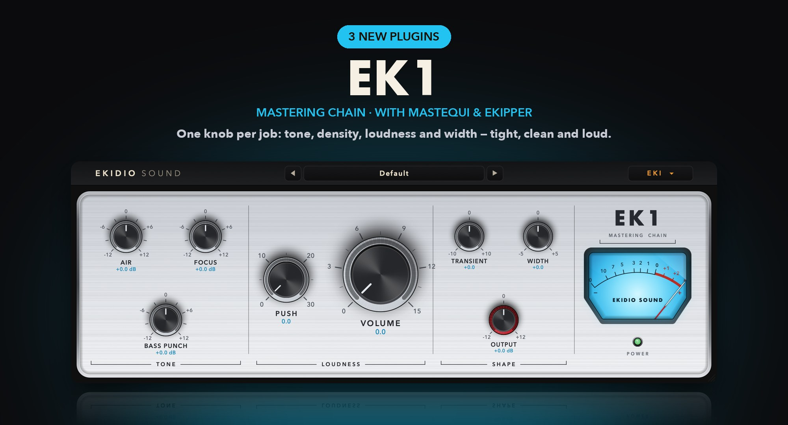

# EKIDIO SOUND — Plugins

Fifteen free, analog-inspired plugins for macOS (Audio Unit / AUv2): eight compressors, a character EQ, a soft tube air enhancer, an analog tape machine, a limiter and three mastering tools.

**Website:** https://ekidio.github.io/ekidio_sound_plugins/ · [Magyar](https://ekidio.github.io/ekidio_sound_plugins/hu/)
**Download:** [the collection, 11 plugins (v1.2.0)](https://github.com/Ekidio/ekidio_sound_plugins/releases/tag/v1.2.0) · [LIMEKI](https://github.com/Ekidio/ekidio_sound_plugins/releases/tag/limeki-v1.0.0) · [EK1](https://github.com/Ekidio/ekidio_sound_plugins/releases/tag/ek1-v1.0.0) · [MASTEQUI](https://github.com/Ekidio/ekidio_sound_plugins/releases/tag/mastequi-v1.0.0) · [EKIPPER](https://github.com/Ekidio/ekidio_sound_plugins/releases/tag/ekipper-v1.0.0) (own installers)



| Plugin | Character |
|---|---|
| **OPTEKI** | optical leveling amplifier |
| **FETEKI** | FET peak limiter |
| **VARIEKI** | variable-mu dynamics (dual peak + RMS detection) |
| **BUSEKI** | stereo VCA bus compressor |
| **APEKI** | punch bus compressor |
| **DBEKI** | RMS compressor / limiter |
| **TUBEKI** | opto tube compressor |
| **FAIREKI** | variable-mu limiter with LAT/VERT |
| **DYNEKI-6** | six-band character EQ (BRIT / PUNCH), M/S, SAT and one-knob COMP |
| **SATEKI** | soft tube air enhancer (three tube stages, 5–16 kHz) |
| **TAPEKI** | analog tape machine (STUDIO / MASTER / CASSETTE, hysteresis tape model, spinning reels) |
| **LIMEKI** | density & clean limiter (analog-style density + look-ahead true-peak limiter, AUTO −14 LUFS) — separate installer |
| **EK1** | one-knob-per-job mastering chain (AIR / FOCUS / BASS PUNCH, PUSH density, two-stage VOLUME limiter, TRANSIENT, WIDTH) — separate installer |
| **MASTEQUI** | three-band mastering EQ with low and air shelves, 2× linear-phase oversampling — separate installer |
| **EKIPPER** | soft clipper (DRIVE, OUTPUT, 2× / 4× / 8× oversampling) — separate installer |

Requirements: macOS 11+, Apple Silicon or Intel, an AU host (Logic Pro, GarageBand, Ableton Live, Reaper…). **Audio Unit (AU) only** — no VST3 version is planned.

## Install

Open the DMG and run **Install EKIDIO SOUND Plugins.pkg** (or a single-plugin one, e.g. **Install EKIDIO SOUND EK1.pkg**). If macOS cannot verify the developer, click *Done*,
then *System Settings → Privacy & Security → Open Anyway*. Restart your DAW.

## Build from source

```bash
Scripts/build.sh all               # universal build, ad-hoc signing, install to ~/Library, auval -strict
Scripts/make-installer.sh          # build/EKIDIO-SOUND-Plugins-<version>.pkg and .dmg (the collection)
Scripts/make-installer.sh LIMEKI   # standalone installer for one plugin: build/EKIDIO-SOUND-LIMEKI-<version>.pkg and .dmg
```

Developer notes (Hungarian): [README.hu.md](README.hu.md)

## License

Free to use, not for redistribution — see [LICENSE.md](LICENSE.md).
