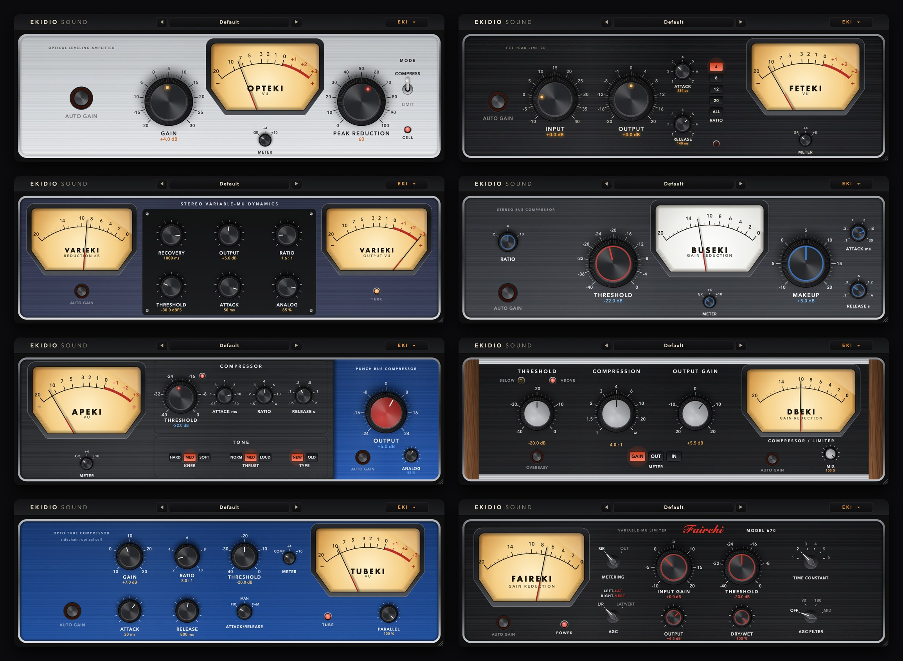

# EKIDIO SOUND — Compressor Collection

Eight free, analog-inspired compressor plugins for macOS (Audio Unit / AUv2).

**Website:** https://ekidio.github.io/ekidio_sound_plugins/ · [Magyar](https://ekidio.github.io/ekidio_sound_plugins/hu/)
**Download:** [latest release (DMG installer)](https://github.com/Ekidio/ekidio_sound_plugins/releases/latest)



| Plugin | Character |
|---|---|
| **OPTEKI** | optical leveling amplifier |
| **FETEKI** | FET peak limiter |
| **VARIEKI** | variable-mu dynamics (dual peak + RMS detection) |
| **BUSEKI** | stereo VCA bus compressor |
| **APEKI** | punch bus compressor |
| **DBEKI** | RMS compressor / limiter |
| **TUBEKI** | opto tube compressor |
| **FAIREKI** | variable-mu limiter with LAT/VERT |

Requirements: macOS 11+, Apple Silicon or Intel, an AU host (Logic Pro, GarageBand, Ableton Live, Reaper…). **Audio Unit (AU) only** — no VST3 version is planned.

## Install

Open the DMG and run **Install EKIDIO SOUND Compressors.pkg**. If macOS cannot verify the developer, click *Done*,
then *System Settings → Privacy & Security → Open Anyway*. Restart your DAW.

## Build from source

```bash
Scripts/build.sh all               # universal build, ad-hoc signing, install to ~/Library, auval -strict
Scripts/make-installer.sh          # build/EKIDIO-SOUND-Compressors-<version>.pkg and .dmg
```

Developer notes (Hungarian): [README.hu.md](README.hu.md)

## License

Free to use, not for redistribution — see [LICENSE.md](LICENSE.md).
